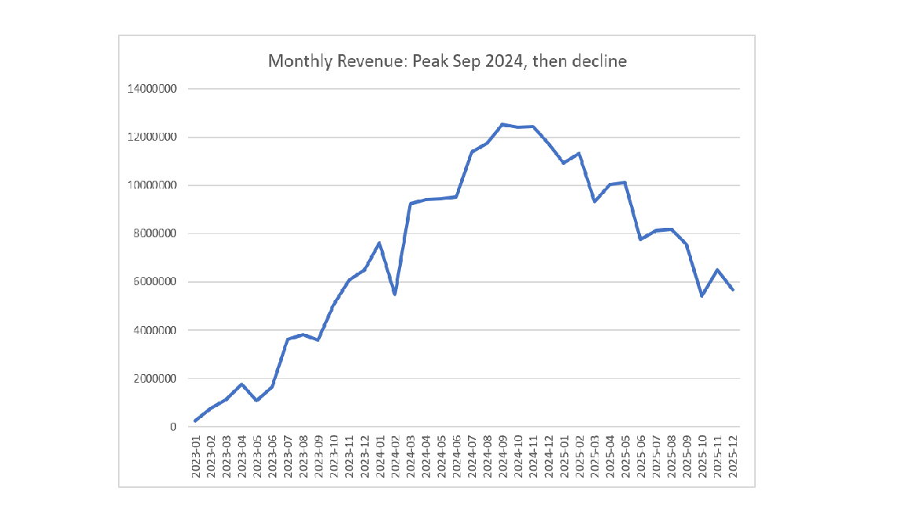
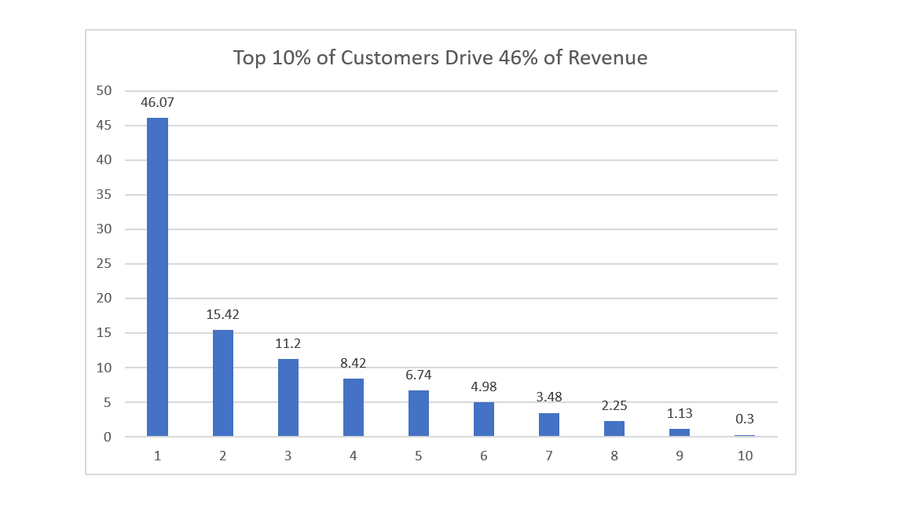
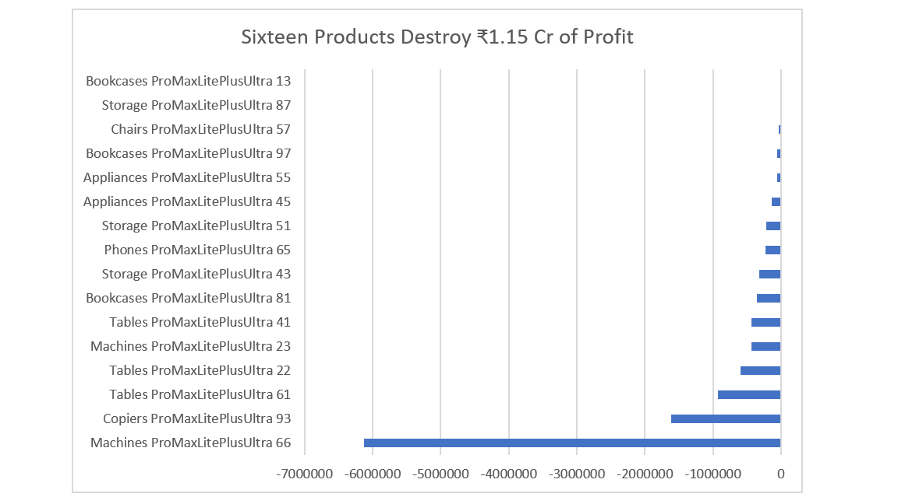
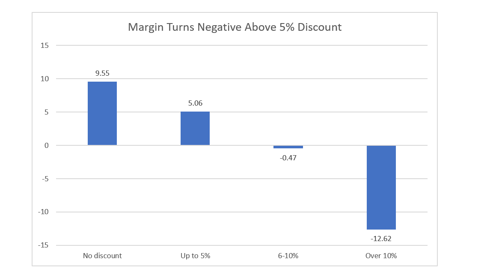

# E-Commerce Sales Analysis (SQL)

## Business question
Where does revenue come from, which customers are worth keeping,
and where is the business losing money?

## Dataset
Four related tables: 1,200 customers, 52 products, 6,735 orders,
16,876 order line items, covering Jan 2023 to Dec 2025.
Synthetic dataset built to practise the full analysis workflow.

## Tools
MySQL 8.0, Excel

## Repository contents
- `ecommerce_analysis.sql` — full analysis script
- `ecom_*.csv` — source data (4 tables)
- `0X_*.csv` — query result exports
- `*.png` — charts

## Data quality checks
- 0 orphan order items, 0 orders predating customer signup
- 9.15% of orders cancelled or returned; excluded from revenue
- 'shipped' orders (5.02%) also excluded as not yet complete
- Revenue definition tested three ways (query 1.5): the decline is
  -54.6% on delivered only, -54.5% including shipped, -57.5% on all
  statuses. The conclusion does not depend on where the line is drawn.

## Key findings

**1. Revenue peaked Sep 2024 (₹12.5M) and fell 55% through 2025.**
From Jan 2024, once monthly volume passed 150 orders, average order
value held in a ₹39-49K band while order count fell from 277 to 120.
The decline is volume, not basket size. (Earlier months are too thin
to read — Jan 2023 had 6 orders.)

**2. The cause was acquisition, not churn.**
No new customer signed up after Nov 2024. Retention is strong —
82% of purchasing customers placed more than one order (1,119 of the
1,200 registered customers ever completed an order; 76% of the full
registered base ordered more than once).

**3. Revenue is highly concentrated.**
The top decile of purchasing customers (112 people) generates 46% of
revenue. The bottom decile contributes 0.3%.

**4. Sixteen products are sold below cost and destroy ₹1.15 Cr of profit.**
Total profit on delivered orders is ₹1.42 Cr, so these 16 SKUs wipe out
45% of what the business would otherwise earn — without them profit
would be ₹2.57 Cr. They also carry 36.6% of revenue, so this is a
pricing or supplier-cost problem, not a demand problem; delisting them
blindly would cost a third of the top line. Worst single product:
Machines ProMaxLitePlusUltra 66, -₹61.2 lakh.

**5. Discounting past 5% destroys profit.**
Undiscounted items: 9.55% margin. 6-10% discount: -0.47%.
Above 10%: -12.62%.

**6. Technology drives 78% of revenue at only 6.32% margin.**

## Recommendations
1. Restart customer acquisition — this is the direct cause of the decline.
2. Reprice or renegotiate the 16 loss-making SKUs. This is the largest
   single profit lever in the data and it touches no other part of the
   business. Delisting is the fallback, not the first move, because
   those products carry 36.6% of revenue.
3. Cap discounts at 5%, testing on one category first.
4. Build retention safeguards for the top decile; losing a few of
   those 112 customers would hurt disproportionately.

## Limitations
cost_price may be COGS only rather than fully loaded cost, so true
margins may be thinner. It is also static across all three years, so a
product that became unprofitable after a supplier price rise cannot be
told apart from one that was always mispriced — separating the two
needs a dated cost table. Discount analysis assumes discounted sales
would have converted at full price, which overstates the gain.

## SQL techniques used
JOIN, GROUP BY, HAVING, CTEs, subqueries, and window functions
(LAG, RANK, NTILE, ROW_NUMBER).

## Charts

